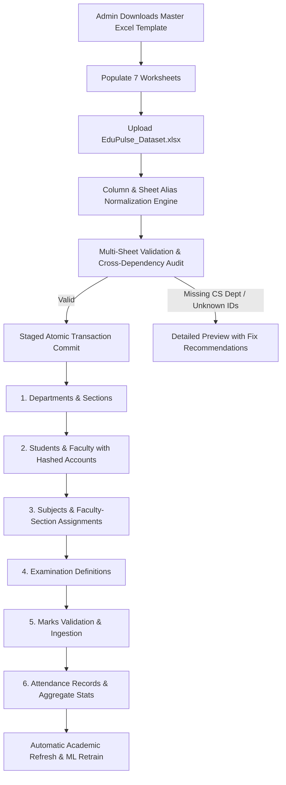

# 🎓 EduPulse — AI-Powered Student Academic Performance Prediction System

EduPulse is a complete, modern, responsive web application for student academic performance analysis, machine-learning-based performance prediction, and personalized academic recommendations.

Built without external generative AI APIs, EduPulse uses conventional machine learning (Scikit-learn Ridge, Random Forest, and Gradient Boosting regressors), statistical analysis, and rule-based diagnostic algorithms to provide transparent, explainable academic insights.

---

## 🌟 Key Features

### 🏛️ 1. Administrator Portal & Dataset Management Engine
- **Academic Data Management Hub**: Complete multi-category import system supporting:
  1. **Departments & Sections**: Setup or update academic departments and section batches.
  2. **Students**: Import enrollments with automatic department & section binding and user account creation.
  3. **Faculty**: Import faculty profiles, designations, and assign them to specific subjects and sections.
  4. **Subjects & Academics**: Upload curriculum catalogs, semester course definitions, and credit structures.
  5. **Examinations**: Configure internal assessments, midterms, practical labs, and semester examinations.
  6. **Subject-Wise Marks**:
     - **Long Format**: One assessment record per row (`roll_number, subject_code, exam_name, marks_obtained, max_marks`).
     - **Wide Format**: Matrix layout with subjects as columns (`roll_number, exam_name, IT101, IT102, ...`), automatically unpivoted by the engine.
  7. **Attendance Records**:
     - **Session Format**: Individual lecture date and status logs (`roll_number, subject_code, date, status`).
     - **Aggregate Format**: Summary class counts (`roll_number, subject_code, total_classes, attended_classes, attendance_percentage`) without fabricating individual sessions.
- **Department & Academic Scope Controls**: Select target department, academic year, semester, and section to filter or bind imports when files lack department codes.
- **Duplicate Detection & Safe Update Policies**:
  - `Skip Existing`: Preserves existing database records and skips duplicates safely.
  - `Update Permitted Fields`: Safely updates student/faculty personal details without touching academic marks or attendance history.
  - `Flag as Duplicate Error`: Flags existing IDs as row validation errors.
- **File Preview & Validation**: Non-destructive pre-validation of columns, dry-run checks against database constraints, and table preview before committing.
- **Import Audit History & Downloadable Error Logs**: Detailed records of all imports with row-level error reports available for instant CSV download.
- **Automated Model Invalidation & Retraining**: Automatically triggers Scikit-learn model retraining when new marks datasets are committed.
- **Comprehensive Academic Export Center**: Instant export of Students, Faculty, Marks Ledgers, Attendance Registers, and Institutional Analytics in both **CSV** and **Excel (.xlsx)** formats.

### 👨‍🏫 2. Faculty Portal
- **Overview Dashboard**: Course assignment counters, class average statistics, and quick action shortcuts.
- **Student Roster**: Filter students by department, section, and semester with contact and enrollment details.
- **Marks Management**: Create assessment tests (Internal Assessments, Semester Exams, Practical Labs) and record marks per student.
- **Attendance Registry**: Mark session attendance (Present/Absent) with automatic calculation of percentages.
- **Performance Analytics**: Subject-wise grade distributions, class averages, and top-performer rankings.
- **ML Predictions & Risk Detector**: Run predictive algorithms to flag students at risk of backlog or scoring below 40%.
- **Question Bank**: Create and manage multiple-choice practice questions categorized by subject and difficulty.
- **Tasks & Alerts**: Assign targeted homework or revision tasks directly to specific students with due dates and priority tags.
- **Authorized Reports & Exports**: Export authorized marks sheets, student rosters, and attendance logs strictly restricted to the faculty's assigned subjects and sections.

### 🎓 3. Student Portal
- **Personalized Dashboard**: Real-time performance indicators, motivational quotes, upcoming deadlines, and quick subject averages.
- **Academic Performance**: In-depth breakdown of all examination scores with interactive Chart.js visualizations and historical logs.
- **Performance Prediction**: ML-forecasted final semester score, confidence metrics, historical trend curves, and what-if goal simulators.
- **Strengths & Weak Areas**: Algorithmic classification into Critical Subjects (<60%) and Key Strengths (≥75%) with recovery strategies.
- **Attendance Audit**: Subject-by-subject attendance percentages, 75% regulatory compliance indicators, and session logs.
- **Weekly Study Plan**: Priority subject study scheduling based on identified weak areas, plus interactive task checklists.
- **Practice Question Bank**: Interactive MCQs with immediate feedback, answer verification, and attempt counters.
- **Self-Improvement Tracker**: Set custom academic goals with deadlines and progress adjustment sliders.
- **Official Reports**: Download complete student marks transcripts and attendance audit sheets in CSV format.

### 👤 4. Unified Profile & Account Management
- **Universal Topbar Profile Dropdown**: Accessible across all portals with user name, role badge, quick links to View Profile, Edit Profile, Change Password, and Sign Out.
- **Self-Service Personal Editing**: Users can edit permitted personal details (display name, email address, phone) with validation while preserving immutable academic attributes (roles, department assignments, roll numbers, marks).
- **Clean Single Login**: Redesigned modern login interface with institutional ID, password toggle control, and secure credential handling.

---

## 🛠️ Technology Stack

| Layer | Technologies |
|---|---|
| **Frontend** | HTML5, CSS3 (Modern Dark Glassmorphism, CSS Custom Properties), JavaScript (ES6+), Chart.js |
| **Backend** | Python 3.11+, Flask, Flask-SQLAlchemy, Flask-Login, Flask-WTF (CSRF Protection), Werkzeug |
| **Database** | SQLite (Production-ready schema migration path to MySQL/PostgreSQL) |
| **Machine Learning** | Scikit-learn (Ridge Regression, Random Forest, Gradient Boosting), Pandas, NumPy, Joblib |
| **Data Processing & Export** | Pandas, OpenPyXL, CSV, ReportLab |

---

---

## 📊 Unified Master Excel Workbook Architecture (`EduPulse_Dataset.xlsx`)

EduPulse features a single-workbook import pipeline that replaces the legacy seven-file workflow with ONE comprehensive `.xlsx` workbook containing seven synchronized worksheets:



### 1. Download Master Template
Admins can click **Download Master Excel Template** from **Admin → Dataset Management**. This generates an `.xlsx` file containing:
- An **Instructions** worksheet with ID relationship guides, column formats, and sample guidelines.
- Pre-formatted sheets with styled navy-blue headers, auto-fitted column widths, and valid synthetic example records across multiple departments (`IT`, `CS`).

---

### 2. Supported Worksheet Schemas & Column Aliases

The import engine normalizes sheet names and column headers automatically (handling case, whitespace, underscores, and common variations):

| Canonical Sheet | Recognized Sheet Aliases | Required Columns | Recognized Column Aliases | Supported Format / Notes |
|---|---|---|---|---|
| **`Departments`** | `Departments`, `Departments & Sections`, `Dept` | `department_code`, `department_name` | `dept_code`, `dept_name`, `department` | Optional: `section_name`, `academic_year`, `semester` |
| **`Students`** | `Students`, `Student Details`, `Student_Data` | `roll_number`, `full_name` | `student_id`, `roll_no`, `name`, `student_name` | Optional: `email`, `department_code`, `section`, `semester`, `academic_year` |
| **`Faculty`** | `Faculty`, `Faculty Details`, `Staff` | `faculty_id`, `full_name` | `staff_id`, `faculty_name`, `name` | Optional: `email`, `department_code`, `designation`, `subject_codes`, `section_assignments` |
| **`Subjects`** | `Subjects`, `Subject Details`, `Courses` | `subject_code`, `subject_name` | `subject_id`, `course_code`, `code`, `title` | Optional: `department_code`, `semester`, `academic_year`, `section`, `faculty_id`, `max_marks` |
| **`Examinations`** | `Examinations`, `Exams`, `Assessments` | `exam_id` or `exam_name` | `examination`, `test_name`, `exam_title` | Optional: `department_code`, `semester`, `academic_year`, `exam_type` |
| **`Marks`** | `Marks`, `Student Marks`, `Results` | `roll_number`, `subject_code`, `exam_id`, `marks_obtained` | `marks`, `score`, `marks_scored`, `max_score` | Supports **Long Format** and auto-unpivots **Wide Format** matrices |
| **`Attendance`** | `Attendance`, `Attendance Records`, `Attendance Logs` | `roll_number`, `subject_code` | `status`, `attendance_status`, `date` | Supports **Session Logs** (`date`, `status`) and **Aggregate Stats** (`total_classes`, `attended_classes`, `attendance_percentage`) |

---

### 3. Department & Academic Intelligence Rules

1. **Department Isolation & Zero Silent Discards**:
   - If students or faculty reference a department (e.g. `CS`) not defined in the `Departments` sheet or database, the importer **explicitly reports the missing department** in the preview and will never silently drop CS students or assign them to IT.
2. **Deterministic Weekly Study Plan**:
   - Generates priority-weighted study tasks based on real academic signals:
     - High Priority: Subjects where marks < 60% or attendance < 75%.
     - Medium Priority: Practice accuracy < 60%.
     - Normal Priority: Maintenance revision for strong subjects (≥75%).
   - Students can mark tasks complete, track progress, and trigger immediate recalculation via **Recalculate AI Study Plan**.
3. **Subject-Scoped Practice Question Bank**:
   - Students only see practice questions for subjects belonging to their registered department and semester.
   - Cross-department questions are strictly filtered out.
   - Interactive feedback verifies option choices, logs attempt history, and updates student practice accuracy.
4. **Faculty Dynamic Assignment & Filtering**:
   - Faculty members access students through explicit `FacultySubjectAssignment` links.
   - Multi-criteria filtering by **Subject**, **Section**, **Semester**, and **Academic Year** dynamically loads cohorts.
   - Strict backend authorization ensures faculty cannot view or modify grades outside their authorized scope.

---

## 🚀 Getting Started

### 1. Prerequisites
Ensure you have Python 3.10+ installed.

### 2. Install Dependencies
```bash
pip install -r requirements.txt
```

### 3. Seed Database & Train Initial ML Models
```bash
python seed_data.py
```

### 4. Run the Application
```bash
python app.py
```
Open your browser and navigate to `http://127.0.0.1:5000`.

---

## 🧪 Comprehensive Verification Suite

Run the full end-to-end verification suite testing all 9 functional layers:
```bash
python test_all_features.py
```

### Test Suite Coverage:
- `[TEST 1]` **Master Excel Template Generation**: Validates workbook creation with all 7 sheets, header styling, and synthetic records.
- `[TEST 2]` **Master Workbook Inspection**: Validates sheet/column alias resolution and row counting.
- `[TEST 3]` **Missing Dependency Detection**: Validates explicit reporting of unconfigured departments (e.g., CS) without silent drops.
- `[TEST 4]` **Atomic Master Import**: Validates transactional commit, ID bindings, and Werkzeug-hashed credentials.
- `[TEST 5]` **Safe Duplicate Prevention**: Validates repeated import under `skip` duplicate policy.
- `[TEST 6]` **Student Portal Workflows**: Validates real-record Dashboard, Performance, Prediction, Weak Areas, Attendance, Deterministic Study Plan, Practice Questions, Goals, and CSV Exports.
- `[TEST 7]` **Faculty Portal Workflows**: Validates assigned cohort Dashboard, dynamic student directory with semester/subject filters, Marks entry, and Question Bank creation.
- `[TEST 8]` **Role-Based Security**: Validates strict backend denial of cross-role and cross-student access.
- `[TEST 9]` **Admin Master Template Endpoint**: Validates downloadable `.xlsx` serving with spreadsheet MIME type.

---

## 🔑 Demo Login Credentials

All initial demonstration accounts have default passwords equal to their account ID:

| Role | User ID / Roll Number | Default Password | Department / Description |
|---|---|---|---|
| **System Admin** | `ADMIN001` | `ADMIN001` | Institution Administrator |
| **Faculty (IT)** | `FACIT01` | `FACIT01` | Information Technology (Assigned IT101, IT102) |
| **Faculty (IT)** | `FACIT02` | `FACIT02` | Information Technology (Assigned IT103, IT104) |
| **Faculty (CS)** | `FACCS01` | `FACCS01` | Computer Science (Assigned CS101, CS102) |
| **Student (IT)** | `IT24001A` | `IT24001A` | IT, Semester 1, Section A |
| **Student (CS)** | `CS24001A` | `CS24001A` | CS, Semester 1, Section A |

